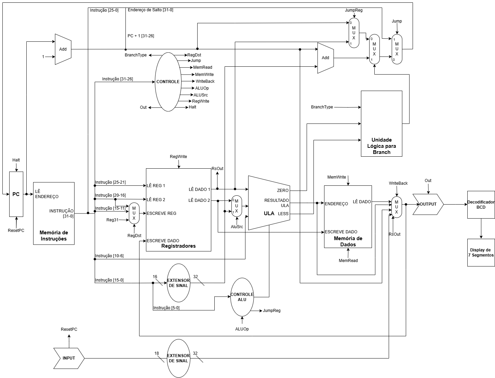

# MIPS 32-bit Single-Cycle Processor

This repository contains the hardware implementation of a 32-bit Single-Cycle MIPS Processor, developed as an academic project. The architecture is strictly based on the design principles and datapath specifications described in "Computer Organization and Design" (2005) by David A. Patterson and John L. Hennessy.

## Project Description

While based on the single-cycle architecture described by Patterson and Hennessy (2005), this project expands upon the original design by introducing additional instructions to the ISA and implementing the necessary structural modifications to the datapath. The project was synthesized and tested for the Altera DE2-115 (Cyclone IV E) FPGA board.
### Technical Specifications
* **Architecture:** MIPS-32 Single-Cycle.
* **Instruction Width:** 32 bits.
* **Target Hardware:** Altera DE2-115.
* **Design Reference:** Patterson & Hennessy (2005).
* **Development Environment:** Intel Quartus Prime.

---

## Instruction Set Architecture (ISA)

The processor implements a functional subset of the MIPS-32 ISA. The table below details the supported instructions, their operations, and their respective formats (R, I, or J).

<table>
  <thead>
    <tr>
      <th align="left">Instruction</th>
      <th align="left">Operation</th>
      <th align="left">Explanation</th>
      <th align="center">Type</th>
    </tr>
  </thead>
  <tbody>
    <tr style="background-color: #f6f8fa;"><td colspan="4"><b>Arithmetic</b></td></tr>
    <tr><td>ADD</td><td><code>rd = rs + rt</code></td><td>Addition</td><td align="center">R</td></tr>
    <tr><td>ADDI</td><td><code>rt = rs + immediate</code></td><td>Addition with immediate</td><td align="center">I</td></tr>
    <tr><td>SUB</td><td><code>rd = rs - rt</code></td><td>Subtraction</td><td align="center">R</td></tr>
    <tr><td>MUL</td><td><code>rd = rs * rt</code></td><td>Multiplication</td><td align="center">R</td></tr>
    <tr><td>DIV</td><td><code>rd = rs / rt</code></td><td>Division</td><td align="center">R</td></tr>
    <tr style="background-color: #f6f8fa;"><td colspan="4"><b>Logic</b></td></tr>
    <tr><td>AND</td><td><code>rd = rs & rt</code></td><td>Logical AND</td><td align="center">R</td></tr>
    <tr><td>ANDI</td><td><code>rt = rs & immediate</code></td><td>AND with immediate</td><td align="center">I</td></tr>
    <tr><td>OR</td><td><code>rd = rs | rt</code></td><td>Logical OR</td><td align="center">R</td></tr>
    <tr><td>ORI</td><td><code>rt = rs | immediate</code></td><td>OR with immediate</td><td align="center">I</td></tr>
    <tr><td>XOR</td><td><code>rd = rs ⊕ rt</code></td><td>Logical XOR</td><td align="center">R</td></tr>
    <tr><td>XORI</td><td><code>rt = rs ⊕ immediate</code></td><td>XOR with immediate</td><td align="center">I</td></tr>
    <tr><td>NOR</td><td><code>rd = ~(rs | rt)</code></td><td>Logical NOR</td><td align="center">R</td></tr>
    <tr style="background-color: #f6f8fa;"><td colspan="4"><b>Shift</b></td></tr>
    <tr><td>SLL</td><td><code>rd = rt << shamt</code></td><td>Shift left logical</td><td align="center">R</td></tr>
    <tr><td>SLR</td><td><code>rd = rt >> shamt</code></td><td>Shift right logical</td><td align="center">R</td></tr>
    <tr style="background-color: #f6f8fa;"><td colspan="4"><b>Data Transfer</b></td></tr>
    <tr><td>LW</td><td><code>rt = Mem[rs + offset]</code></td><td>Load word</td><td align="center">I</td></tr>
    <tr><td>SW</td><td><code>Mem[rs + offset] = rt</code></td><td>Store word</td><td align="center">I</td></tr>
    <tr><td>LUI</td><td><code>rt = immediate << 16</code></td><td>Load upper immediate</td><td align="center">I</td></tr>
    <tr style="background-color: #f6f8fa;"><td colspan="4"><b>Conditional Branch</b></td></tr>
    <tr><td>BEQ</td><td><code>if rs == rt: PC = PC + offset</code></td><td>Branch if equal</td><td align="center">I</td></tr>
    <tr><td>BNE</td><td><code>if rs != rt: PC = PC + offset</code></td><td>Branch if not equal</td><td align="center">I</td></tr>
    <tr><td>BLT</td><td><code>if rs < rt: PC = PC + offset</code></td><td>Branch if less than</td><td align="center">I</td></tr>
    <tr><td>BGT</td><td><code>if rs > rt: PC = PC + offset</code></td><td>Branch if greater than</td><td align="center">I</td></tr>
    <tr><td>BLE</td><td><code>if rs <= rt: PC = PC + offset</code></td><td>Branch if less or equal</td><td align="center">I</td></tr>
    <tr><td>BGE</td><td><code>if rs >= rt: PC = PC + offset</code></td><td>Branch if greater or equal</td><td align="center">I</td></tr>
    <tr style="background-color: #f6f8fa;"><td colspan="4"><b>Unconditional Branch</b></td></tr>
    <tr><td>J</td><td><code>PC = address</code></td><td>Jump to address</td><td align="center">J</td></tr>
    <tr><td>JAL</td><td><code>reg = PC; PC = address</code></td><td>Jump and link (subroutine call)</td><td align="center">J</td></tr>
    <tr><td>JR</td><td><code>PC = Reg[rs]</code></td><td>Jump register (return)</td><td align="center">R</td></tr>
    <tr style="background-color: #f6f8fa;"><td colspan="4"><b>Control & I/O</b></td></tr>
    <tr><td>NOP</td><td><code>-</code></td><td>No operation</td><td align="center">J</td></tr>
    <tr><td>HALT</td><td><code>-</code></td><td>Stop execution</td><td align="center">J</td></tr>
    <tr><td>IN</td><td><code>rt = input (switches)</code></td><td>Input from hardware switches</td><td align="center">I</td></tr>
    <tr><td>OUT</td><td><code>output = Reg[rs]</code></td><td>Output to hardware LEDs/display</td><td align="center">I</td></tr>
  </tbody>
</table>

---

## Datapath

The datapath logic follows the standard single-cycle organization. Every instruction is fetched, decoded, and executed within a single clock period. The architecture includes the Program Counter (PC), Instruction Memory, Register File, 32-bit ALU, and Data Memory interfaces.

The schematic below illustrates the signal flow and component interconnections:

---

## Repository Structure
* `/src`: All Verilog/VHDL source files for the MIPS processor logic.
* `/docs`: Technical report, ISA tables, and datapath schematics.
* `/simulation`: Testbenches and simulation files (ModelSim/Quartus).
* `/waveforms`: Waveform images used in developmnent.
* `*.qpf / *.qsf`: Quartus project and settings files (including pin assignments for DE2-115).
